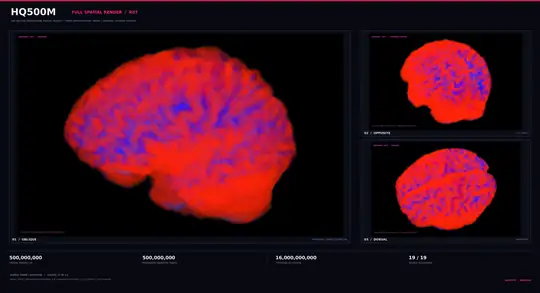

# Mikoshi HQ500M — CPU Playground

<!-- HQ500M_README_HERO_START -->
<!-- Keep the atlas image and viewer links directly below the project title. Never prepend release notes above this pinned block. -->

[](docs/images/hq500m-r08-deep-ruby.webp)

**[Interactive Deep Ruby 3D viewer](https://garyu-tt.github.io/mikoshi-hq500m/)** · **[Full-size atlas image](docs/images/hq500m-r08-deep-ruby.webp)** · [Viewer source](docs/index.html) · [Geometry credits](docs/CREDITS.md)

The interactive R14 viewer uses **all 1,192,673 original point-cloud positions** and **520,150 sampled deterministic Q0.8 neural-address pairs**, with GPU depth occlusion (not every potential edge). 500 million virtual addresses and 16 billion potential connections describe the **synthetic HQ500M architecture**, not simultaneously simulated neurons or measured human axons.

*HQ500M R08 Deep Ruby — a computed, synthetic spatial visualization, **not** a measured human connectome. Point-cloud geometry adapted from [Brain Point Cloud](https://sketchfab.com/3d-models/brain-point-cloud-c427ea0aee214141a78eba37bf9b76bb) by Terrie ([CC BY 4.0](https://creativecommons.org/licenses/by/4.0/)); image palette and layout customized for Mikoshi.*

**Atlas details:** [R13 sulcal-depth manifest](docs/assets/manifest_r13.json) · [Sulcal-depth method](docs/R13_SULCI.md).

<!-- HQ500M_README_HERO_END -->


## R21 — Smoother dense brain, no straight-through synthetic fiber web

**[Open the updated procedural atlas R21](https://garyu-tt.github.io/mikoshi-hq500m/procedural/)**.

The dense R20 point-cloud model is preserved, but optional synthetic
connections now default to **short, gently curved, depth-occluded
within-region fibers** instead of distant full-brain chords. The
individual directed neuron ID graph and schematic HRA tract mode still
support focused path inspection. Visible cortical glyph coverage
is slightly stronger without storing any additional geometry or
materializing 500M / 86B virtual neurons.

Connections remain synthetic illustrations, not anatomically
reconstructed axons/synapses.

[Technical change and tests](docs/R21_LOCAL_FIBERS.md) ·
[Local connection screenshot](docs/images/r21_local_fibers.png).


## R20 — Dense Procedural Neural Atlas (adaptive GPU LOD)

[Open the denser procedural brain](https://garyu-tt.github.io/mikoshi-hq500m/procedural/).

R20 increases on-screen synthetic neuron proxy density without
increasing the saved HRA stencil or changing the configured virtual
neuron count. Automatic desktop density now renders about **220,000
points at 500 million virtual neurons** and **682,889 points at 86.1
billion virtual neurons**; manually adjustable up to **1,100,000**
points on desktop, capped at **120,000** on mobile. The old R18 default
rendered 24,000 and 101,461 respectively.

Unselected regions stay hidden internally, with the R19 directed
synthetic neuron graph / tract explorer unchanged. Point sizes adapt
to the actual GPU sample count. This is a visual density proxy, **not**
new biologically measured neurons or synaptic morphology.

[R20 method and validation](docs/R20_DENSE_LOD.md) ·
[R20 dense preview](docs/images/r20_dense_861b.png).


## R19 — Procedural Neural Path Explorer with stable neuron IDs

**[Open the R19 model and explore neuron paths](https://garyu-tt.github.io/mikoshi-hq500m/procedural/)**.

R19 adds a deterministic synthetic directed graph on top of R18's
compact 283-structure HRA atlas stencil. Select any virtual neuron ID
in the configured 500M, 8.6B, 86.1B (or custom) population to examine
a bounded connected subgraph or an ID-to-ID path. Region-linked ID
positions are computed on demand in spatial Morton order. The same
neuron ID and links are stable when changing the GPU rendering LOD.

All unselected inner regions remain hidden unless explicitly selected.
The synthetic graph has bounded memory usage: it is NOT a stored
86B connectome, and projected connections are not measured synapses.

[Detailed R19 architecture, scientific limits and browser tests](docs/R19_DYNAMIC_NEURAL_GRAPH.md).
[Rendered ID-based graph example](docs/images/r19_graph_tree_demo.png).


## R18 - Procedural Neural Atlas, scalable 500M / 8.6B / 86.1B

[Open the procedural 3D atlas](https://garyu-tt.github.io/mikoshi-hq500m/procedural/).

All 283 HRA/Allen anatomical regions provide compact, invisible
geometric stencils for on-demand neuron proxies. Enter a virtual
neuron count and obtain scaled estimated per-region counts; only
bounded LOD samples are materialized on the GPU. Exterior regions
remain visible, and interiors are revealed only on selection.
Synthetic links and named white matter tract previews are optional.

Region counts are **model estimates**, not measured per-region
neuron or synapse measurements. Underlying HQ500M/Q0.8, Terrie
and HRA source geometries are unchanged.

[Method and source provenance](docs/R18_PROCEDURAL_NEURAL_ATLAS.md) · [R18 screenshot](docs/images/r18_procedural_smoke.png).


## R17 - Anatomical HRA reference from NeutralLab (283 structures)

[Open the source human brain anatomy viewer](https://neutrallab.infracare-it.com/viewer/).

A searchable catalogue of 283 named HRA/Allen v1.3 anatomical
mesh structures now appears in HQ500M. Each name links to the
corresponding original mesh in NeutralLab's independent 3D viewer.

V5 has 110404 synthetic voxel slots geometrically assigned
to 265 atlas tissue meshes (18 cavities excluded). These are NOT
real neurons. The atlas is NOT registered to the 1.19M-point
HQ500M source or its 500M synthetic neural IDs. Its eight-zone
R16 colors remain separate illustrative hypotheses.

[Provenance, limitations and tests](docs/R17_HRA_NEUTRALLAB_REFERENCE.md).


## R16 — Smooth region candidates and Neural Path Explorer

The R14-R15 flat cerebellar-region boundary was replaced with eight
continuously blended spatial **candidate** regions. Geometry, Q0.8
fiber sample and original neuron IDs remain unchanged. The viewer
includes a working experimental **Neural Path Explorer** with directed
Q0.8 ID neighbors, bounded ID-to-ID path search, and sampled R11
region-to-region projection filtering. You can hide, dim or show
the rest of the 3D model while examining the chosen segments.

**Important:** the eight zones are heuristic, NOT validated anatomical
segmentation. For searched Q0.8 IDs, line endpoints use stable
*display proxies* until true ID-to-XYZ mapping is available. The region
mode groups *sampled synthetic edges*, not proven continuous neuronal
tracts. There are no measured human axons, synapses or SWC skeletons.

[Implementation, assumptions, file formats and tests](docs/R16_SMOOTH_REGIONS_AND_PATH_EXPLORER.md).


## R15 — boundary-stable density preview (source geometry preserved)

The interactive 3D viewer now layers *geometric boundary stability* over
the provisional R14 regions. The candidate cerebellar zone can render
with finer glyphs and higher proxy sample density **without submitting
the entire cloud repeatedly**. All original 1,192,673 point positions,
Q0.8 fiber endpoints and 500M virtual neuron IDs are unchanged.

High boundary stability means neighboring *heuristic* labels agree; it
**does not verify a real cerebellum or a registered anatomical atlas**.
MNI/SUIT alignment is a separate future step.

[Method, validation and atlas requirements](docs/R15_BOUNDARY_STABLE_DENSITY.md).


## R14 — anatomical-density view (reversible, provisional)

The [interactive viewer](https://garyu-tt.github.io/mikoshi-hq500m/) now supports **tentative regional annotations**, a density-aware neuron glyph radius, and an adjustable cerebellum detail setting. It preserves all **1,192,673 original point-cloud coordinates**, the original R13 sulcal coloring and the original R11 sampled Q0.8 fiber pairs. The R14 region/density maps are additional sidecar files. The 500M virtual neuron IDs and simulator are unchanged.

A typical human brain has roughly 69B cerebellar neurons despite the cerebellum accounting for only about 10% of brain mass. This is used for *illustrative relative density*, not a claim that we reconstructed or instantiated 69B cells. **The Terrie source has no verified neuroanatomical regional labels; candidate boundaries and even the cerebellum's presence in this point cloud require independent atlas validation.** No original model geometry is stretched or overwritten.

[Implementation, data, caveats and tests](docs/R14_REGIONAL_DENSITY.md).


## Fusion R08 — CPU dendritic residual activity (experimental)

This CPU-only patch adds an optional, **bounded sparse wake map** for
R07 four-branch dendritic neurons. Charged branches continue integrating
for up to eight subsequent silent ticks, allowing delayed spikes without
allocating all 500 million virtual neuron IDs. Checkpoints persist exact
awake IDs and expiration times; the default zero tail is R07-compatible.

    python3 -m hq500m demo --engine paged --dendrites --dendrite-tail 4
    python3 -m unittest discover -s tests -v

There is no GPU dependency. This is still a synthetic four-branch
proxy, not a human neuronal or dendritic reconstruction; CPU tail work
is bounded by a safety cap and may be slow for dense event streams.
See [R08 CPU tail design](docs/FUSION_R08_CPU_DENDRITE_TAIL.md).

## Fusion R07 — optional synthetic dendritic compartments

The exact-ID paged CPU simulator now supports an **opt-in four-branch
dendritic proxy**. C5 synaptic inputs land on deterministic branch
groups, each branch leaks independently, and local coincident input can
produce a supralinear somatic contribution. Signed inhibition and
checkpoint/replay are supported; no 500M-wide branch array is allocated.

    python3 -m hq500m demo --engine paged --dendrites
    python3 -m unittest discover -s tests -v

Legacy mode and default checkpoints are unchanged. Native C99 LIF is
not compartment-aware and is rejected in dendrite mode. The synthetic
C5 slot-to-branch mapping is **not human neuron morphology** and this
does not convert the toy network into a human connectome.
[Design, limits and validation](docs/FUSION_R07_DENDRITES.md).

## Fusion R06 — million real CPU membrane integrations (experimental)

**Measured, not extrapolated:** a bounded CPU test with 32,768
one-time externally driven source neurons delivered 1,048,576
original C5 synaptic events, including 262,144 remote, and genuinely
integrated **1,080,623 distinct neuron IDs** over two ticks.
Only **32,768** of those distinct neurons fired; the remainder
received currents and updated their membranes. This is NOT a
million autonomous firing neurons, a trained LLM or biological brain.

- Standard library CPU engine now supports opt-in
  **--lab-max-pulses 32768** (default remains 8192) for research.
- New native C99 event reduction and dense-page lazy LIF math are
  available via **--event-kernel native** and
  **--lif-kernel native**. All default to Python.
- Native and Python event/LIF versions match exactly in independent
  tests, including plasticity and checkpoint continuation.
- On the real ~1M-updated sparse workload, C event-array packing
  adds overhead; **native is not yet faster**, and native LIF stays
  disabled for sparse pages. The next optimization is native
  page-state ownership with zero Python tuple round-trips.

~~~sh
sh hq500m/native/build.sh # optional native kernel build on Linux with C99 compiler
python3 -m hq500m demo --engine paged --kernel native --event-kernel native --lif-kernel native
python3 benchmarks/fusion_r06_bench.py --large --repeats 2
python3 -m unittest discover -s tests -v
~~~

The large benchmark is **optional** and may require significant
time and RAM on slower machines. No service or existing model was
overwritten. [Fusion R06 validation, raw numbers, design and
limits](docs/FUSION_R06.md).

## Fusion R05 — optional native C99 exact C5 generator

The optional paged CPU engine can use a **compiled C99 batch generator** for
the original C5 32-synapse topology (24 local + 8 remote). A separate Python
implementation remains the default and checks exact target IDs and weights.
This is not a CUDA port or the GPU BitWeave R04 matrix multiplication engine.

~~~sh
# Linux, C99 compiler installed (requires no extra Python dependencies)
sh hq500m/native/build.sh
python3 -m hq500m demo --engine paged --max-pages 128 --kernel native
python3 -m hq500m demo --engine paged --max-pages 128 --kernel python
python3 benchmarks/fusion_r05_native_bench.py
python3 -m unittest discover -s tests -v
~~~

If the native library is missing, the default Python path still works;
the explicit native flag fails with a clear error. Kernel auto uses native if
installed, otherwise Python; it does NOT yet implement an adaptive
hot/cold or sparse/dense performance crossover.

On the verified mirbi-linux CPU, the C99 path ran **1.34–1.56x faster**
for C5-cold full-step tests (1,024–8,192 driven sources), with all neural
outputs identical; after warming the Python C5 LRU, native ranged from
**0.92–0.95x** the cached Python baseline. Native therefore remains
strictly OPT-IN. These are host-specific CPU results, not tokens/sec,
not GPU speed, and not a million firing neurons.
[Read R05 methodology, raw data, limitations](docs/FUSION_R05.md).

## Fusion R04 — recurrent neural events and controlled associative learning

The **optional** paged CPU engine now supports an experimental
--threshold (0.25..2.0, default 1.0) and --plasticity-scope all_exc
(positive local C5 plasticity; default remote-only). No synthetic C5
topology changes, GPU dependency or pretrained weights have been added.

- In a 25-case sweep, original C5 recurrence remained active on tick 24
  in 0/5 source modules at threshold 1.0, 3/5 at 0.35 and 5/5 at 0.25.
  Four selected cases continued to tick 72 without fresh input.
  These repeated spikes are **not** validated cognition or useful learning.
- In an 11-eligible-module, topology-conditioned cue/teacher experiment,
  **5/11** learned a cue-alone target spike after 25 pairings. Four
  matched control conditions achieved **0/11**. All five successful
  readouts were retained after 256 silent ticks, checkpoint restoration,
  and a separate distractor test.
- Distinct counters now separate updated / spiking / unforced neurons
  and spiking outside the originally stimulated pages. Expired causal
  traces are garbage-collected; old default-mode checkpoints remain
  readable. The 500M neurons remain virtual addressable IDs.

~~~sh
python3 -m hq500m demo --engine paged --max-pages 128 --threshold 0.35
python3 -m hq500m demo --engine paged --max-pages 128 --plasticity-scope all_exc
python3 assays/fusion_r04_assay.py
python3 assays/fusion_r04_criticality.py
python3 -m unittest discover -s tests -v
~~~

**Research mode, not a recommended permanent threshold of 0.25:**
near-critical reverberation can drive expensive repetitive loops.
[Full Fusion R04 report and limitations](docs/FUSION_R04.md).
28/28 unit/integration tests passed on mirbi-linux.

## Fusion R03 — faster exact-C5 paging and measured intrinsic activity

**Optional CPU mode, no CUDA requirement.** Fusion R03 reduces repeated
source-edge calculation and page churn while preserving exact C5 source
and target IDs, signed weights and previous checkpoint semantics. In a
repeatable 3-trial 2-tick CPU comparison, the event-handling path ran
1.43x to 2.16x faster than R02 depending on the workload. A 24-tick
test starting with 512 directly stimulated cells observed 83-125
**additional** cells fire via original C5 wiring, with no artificial
broadcast; each tested cascade then died out after about three ticks.
This is real propagation, not sustained self-organization or cognition.

~~~sh
python3 -m hq500m demo --engine paged --max-pages 1024 --ticks 4
python3 benchmarks/fusion_r03_bench.py --sources 1024 4096 8192 --trials 3
python3 -m unittest discover -s tests -v
~~~

[Full Fusion R03 technical notes, performance comparisons and
limitations](docs/FUSION_R03.md). All 24 local tests passed; the
default legacy engine remains unchanged. 500M neurons still denote
**virtual address capacity**, not 500M simultaneously simulated neurons.

## Fusion R02 — exact-address dynamic CPU neuron paging

A second optional mode, **paged**, now delivers original 24 local and 8
projected C5 synapses to their exact 500M-space target IDs. Page misses
load the requested 1,024-address module, LRU evictions preserve cold
membrane states in RAM, and checkpoint files retain queued remote events
and toy plasticity deltas. It does **not** use synthetic fanout. See
[Fusion R02 details, tests and limits](docs/FUSION_R02.md).

~~~bash
python3 -m hq500m demo --engine paged --max-pages 128 --ticks 4
python3 -m hq500m demo --engine paged --max-pages 1024 --ticks 4
~~~

On a 32-vCPU Xeon CPU, a two-tick laboratory pulse test with 4,096 distinct
externally driven source neurons integrated 135,162 distinct neurons and
delivered 131,072 exact C5 synapse events in 0.963 s, including 32,768
cross-module events. This is **not** 135K independently firing neurons:
only the 4,096 stimulated sources fired. Up to 1,048,576 *logically
resident addresses* fit the page budget; no claim is made that a million
neurons were actually updated. Default/legacy behavior is unchanged.

## Expanded CPU simulation — BitWeave-inspired sparse event engine (R01)

An **opt-in** CPU-only engine now supports 1–128 resident 1,024-neuron pages in each of seven regions (up to 917,504 **resident** virtual addresses) with packed spike bitsets, popcount and lazy LIF updates. This is a **BitWeave-inspired CPU adaptation**, NOT the CUDA R04 binary-GEMM kernel.

~~~bash
python3 -m hq500m demo --engine bitweave --pages 16 --fanout 16 --ticks 3
python3 -m hq500m demo --engine bitweave --pages 64 --fanout 16 --ticks 3
~~~

On a 32-vCPU Xeon E5-2660 v4 host, a single three-tick step with one food input activated **1,819** unique firing neurons out of 114,688 resident (0.322 s) at 16 pages/region; at 64 pages/region it activated **7,196** out of 458,752 resident (1.286 s). These counts require **explicitly artificial sensory fanout**; they are not demonstrated cognition or genuine C5-driven propagation. The 500M neuron address space is still virtual; only resident destinations receive C5 events. The regular playground remains the default, compatible mode.

See [full engine explanation, limitations and reproducible measurements](docs/BITWEAVE_CPU.md). 14 original and new unit/integration tests passed locally.


**A tiny, hackable neural sandbox with 500,000,000 virtual neuron addresses, named sensory/motor ports, and zero GPU requirements.**

This is the **public toy release**, not our large research installation. It runs on an ordinary computer using Python 3.11+ and the standard library only.

- **500,000,000 fixed, virtual addresses**; 32 on-demand potential outgoing edges per address.
- **896 active toy neurons by default** (7 regions × 128 cells); selectable **896 / 1,792 / 3,584 / 7,168** at runtime.
- 15 named sensory inputs, 6 motor outputs, synthetic functional bridges, spiking dynamics, simple reward-based plasticity and local checkpoint save/load.
- Compatible game-style observation keys from BrainFryGameAgent (`food`, `threat`, `obstacle`, `novelty`, `hunger`, `fatigue`, `reward`).
- Plain Python API, newline-delimited JSON or **localhost-only HTTP API** for game engines.

> **Important:** The 500 million neurons are *not simultaneously active*. This is a small **synthetic** network in a large **virtual** address space. The names cortex, thalamus, eye, spinal cord, etc. designate **hypothetical functional ports**, not biological reconstructions. It contains no human connectome, no quantum computation, and no claim of consciousness.

## Try it in under a minute

```bash
git clone https://github.com/Garyu-tt/mikoshi-hq500m.git
cd mikoshi-hq500m

python3 -m hq500m demo
python3 -m hq500m ports
python3 examples/simple_game.py
python3 -m unittest discover -s tests -v
```

**No** `pip install`, GPU, CUDA, pretrained model weights, paid API, database or network access is needed.

Try larger active windows, still with exactly 500 million virtual addresses:

```bash
python3 -m hq500m demo --cells 256
python3 -m hq500m demo --cells 1024
python3 -m hq500m query 499999999
```

The `--cells` number is **per region**. It changes RAM/CPU workload but never changes the fixed virtual network size.

## Connect to a game

**Option A: directly from Python**

```python
from hq500m import Brain

brain = Brain(cells=128, ticks=6)
reply = brain.step({
    "eye_left": 0.8,        # left-eye sensory channel
    "obstacle_left": 0.9,   # game sensor: obstacle on left
    "spinal_sensory": 0.2,  # body-state feedback
    "reward": 0.0          # feedback about the previous action
})
print(reply["action"], reply["motor_spikes"])
# Your game applies the chosen command. The model does NOT control the game itself.
```

**Option B: pipe JSON lines (one input/response per line)**

```bash
python3 -m hq500m jsonl
```

Send one line:

```json
{"observation":{"eye_left":0.8,"obstacle_left":0.9,"reward":0}}
```

Output includes `action`, `motor_spikes`, `motor_scores`, `spikes`, `step`, `resident_neurons` and `virtual_neurons`.

**Option C: localhost HTTP**

Terminal 1:

```bash
python3 -m hq500m server --port 8766 --state-file ./brain-state.json
```

Terminal 2:

```bash
curl http://127.0.0.1:8766/v1/ports
curl -s -X POST http://127.0.0.1:8766/v1/step \
  -H 'Content-Type: application/json' \
  -d '{"observation":{"food":1,"threat":0,"reward":0}}'
```

Endpoints: `GET /health`, `GET /v1/ports`, `POST /v1/step`. Server binds **only** to `127.0.0.1`. It is intentionally unauthenticated; do not reverse-proxy or expose it publicly without your own authentication and access policy.

The `reward` input is in [-1,1] and refers to the **previous** action, not the one the model is currently choosing. Omitted sensors default to 0. Sensor values must be finite numbers between -1 and 1. Motor commands are `forward`, `left`, `right`, `interact`, `retreat`, and `idle`. Your game adapter must handle physics, collisions, permissions and safety limits.

## Anatomical-style connector guide

| Role | Input / output ports | Toy region |
| --- | --- | --- |
| Vision | `eye_left`, `eye_right` | Thalamus |
| Hearing | `ear_left`, `ear_right` | Thalamus |
| Touch | `touch` | Thalamus |
| Body/spinal ascending input | `spinal_sensory` | Brainstem |
| Balance | `balance` | Cerebellum |
| Hunger, danger, smell | `hunger`, `threat`, `smell` | Limbic |
| Novelty/context | `novelty` | Hippocampus |
| Motion to game | `forward`, `left`, `right`, `retreat` | Brainstem |
| Interaction and no-op | `interact`, `idle` | Cortex / basal ganglia |

**Actual global neuron ID ranges, all 15 inputs, six outputs, bridge destinations and examples:** [EN connector map](docs/PORTS.md) · [Русская инструкция](docs/PORTS_RU.md). You can also inspect the machine-readable map using `python3 -m hq500m ports` or `GET /v1/ports`.

No spinal neurons are actually simulated: the ascending `spinal_sensory` and descending brainstem motor ports are **integration points** that game developers connect to avatar sensors and actions.

## What does this actually simulate?

The original HQ500M deterministic 32-edge address generator is implemented on CPU. Only potential edges whose endpoints are in the currently resident tiny windows participate in the toy LIF-like simulation. To make game interaction legible, **additional named sensor→motor bridges** are connected explicitly; these bridges are **not** the original procedural C5 edges or measured human pathways.

A tiny action-value table and bounded bridge gains can be modified by `reward`; this is a game-learning demonstration, **not** proof of emergent intelligence. State is saved only when `--state-file` is specified (or you call `Brain.save(path)`).

The **historical CUDA implementation** is not needed for the public CPU entrypoint. The old CUDA Q0.8 experiments do not validate the toy game-port mapping; treat them as separate research.

## License

GPL-3.0-or-later (see [LICENSE](LICENSE) and [AUTHORS.md](AUTHORS.md)). Contributions, alternative adapters, games and experiments are welcome.
